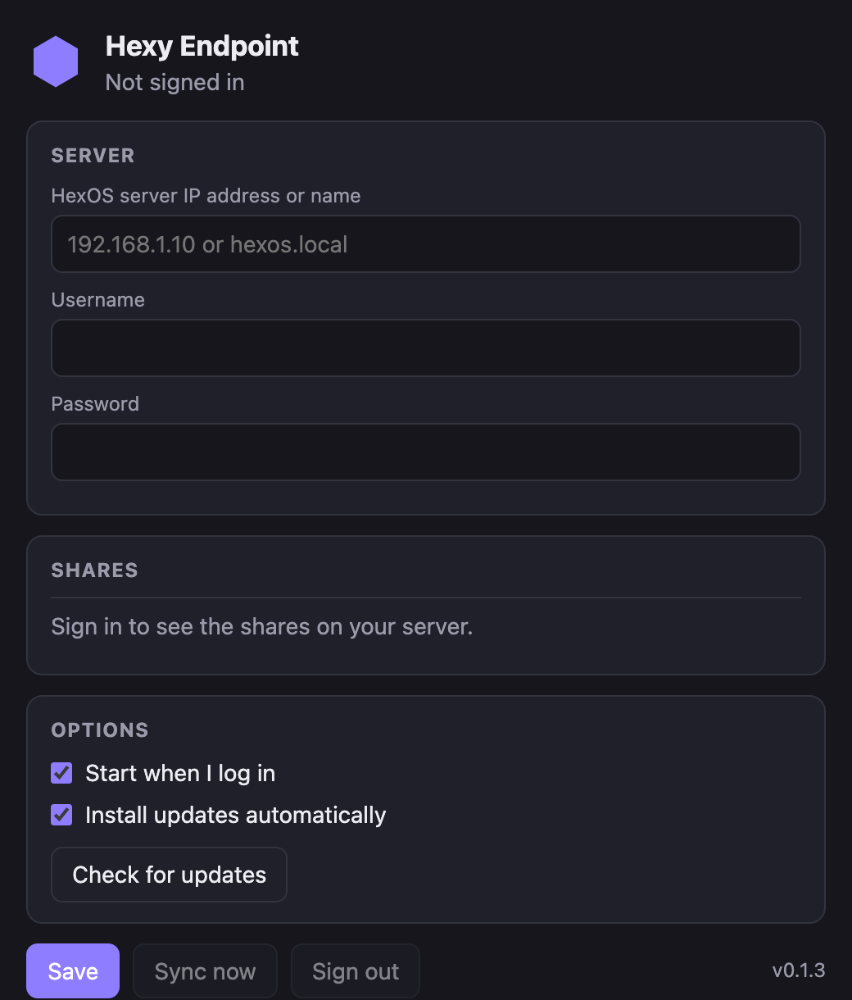
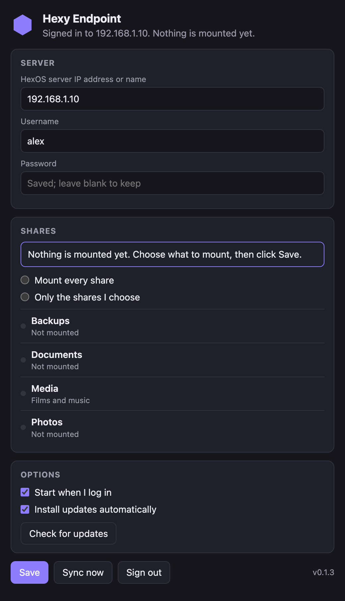
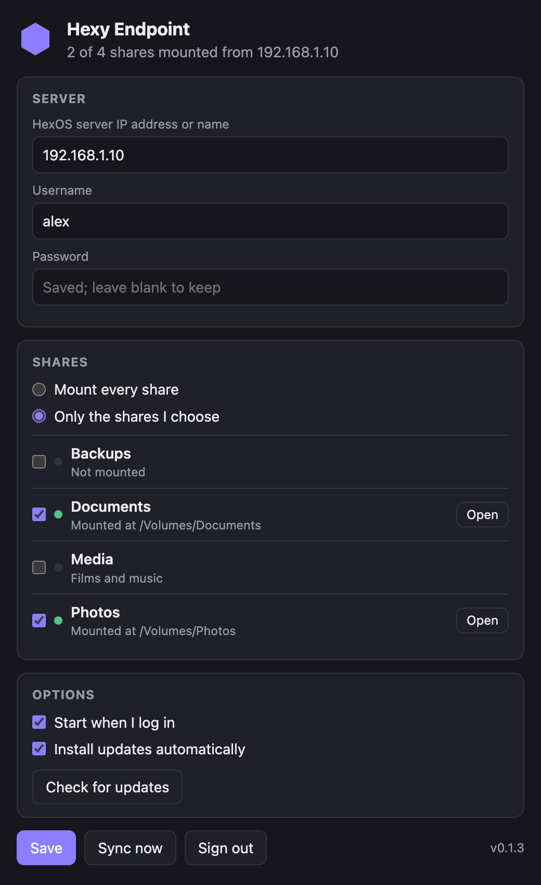
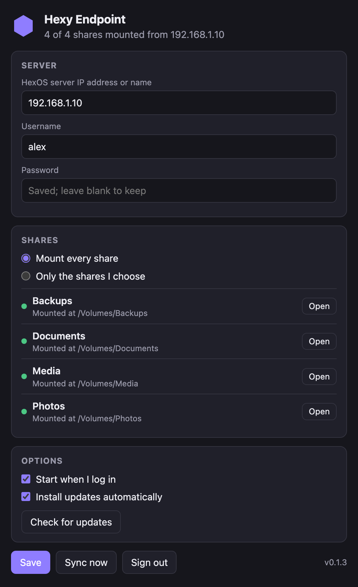
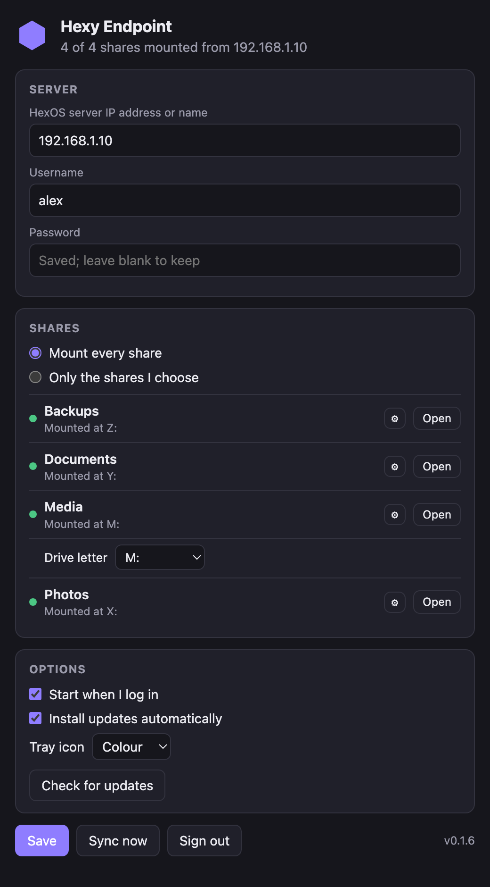

# Hexy Endpoint

A small tray app for Windows, macOS and Linux that keeps the shares on a
[HexOS](https://hexos.com) server mounted on your computer.

## Download

These links always fetch the newest version.

| Your computer | Download |
|---|---|
| Mac with Apple Silicon (M1 or newer) | [Hexy-Endpoint-macOS-Apple-Silicon.dmg](https://github.com/Dimtar/hexy-endpoint/releases/latest/download/Hexy-Endpoint-macOS-Apple-Silicon.dmg) |
| Mac with an Intel processor | [Hexy-Endpoint-macOS-Intel.dmg](https://github.com/Dimtar/hexy-endpoint/releases/latest/download/Hexy-Endpoint-macOS-Intel.dmg) |
| Windows | [Hexy-Endpoint-Windows.exe](https://github.com/Dimtar/hexy-endpoint/releases/latest/download/Hexy-Endpoint-Windows.exe) |
| Linux | [AppImage](https://github.com/Dimtar/hexy-endpoint/releases/latest/download/Hexy-Endpoint-Linux.AppImage) · [.deb](https://github.com/Dimtar/hexy-endpoint/releases/latest/download/Hexy-Endpoint-Linux.deb) · [.rpm](https://github.com/Dimtar/hexy-endpoint/releases/latest/download/Hexy-Endpoint-Linux.rpm) |

Not sure which Mac you have? Apple menu → **About This Mac**: "Chip" means
Apple Silicon, "Processor" means Intel. Then see [Using it](#using-it).

Give it your server's address and a HexOS username and password. It then:

- lists the shares that account can see and asks whether to mount all of them or only the ones you tick;
- starts when you log in and stays in the system tray;
- asks the server for its share list once a minute, mounting shares that were
  added and unmounting ones that were removed;
- updates itself from this repository's GitHub Releases.

It only ever unmounts shares it mounted itself, so anything you mounted by hand
is left alone.

## Using it

The screenshots below show the app with sample data.

### 1. Install

Download the installer for your computer from the [Download](#download)
section at the top of this page. Older versions are on the
[releases page](https://github.com/Dimtar/hexy-endpoint/releases).

The app is not signed with a paid Apple or Microsoft certificate, so the first
launch needs one extra step:

- **macOS:** drag the app to Applications and open it. macOS will say it cannot
  verify the developer. Open **System Settings → Privacy & Security**, scroll
  down, and click **Open Anyway**. If macOS instead says the app "is damaged",
  run `xattr -cr "/Applications/Hexy Endpoint.app"` in Terminal and open it again.
- **Windows:** on the SmartScreen warning, click **More info**, then **Run anyway**.

### 2. Sign in

Enter your HexOS server's IP address or name, and the username and password
of a HexOS account that has access to the shares. Click **Save**.



The address is just the host, for example `192.168.1.10` or `hexos.local`,
with no `smb://`. The account does not need to be an admin.

### 3. Choose what to mount

Signing in only lists the shares the account can see. Nothing is mounted until
you choose:



- **Mount every share** mounts everything on the server, including shares
  added to it later.
- **Only the shares I choose** lets you tick the ones you want. A share added
  to the server later is listed but not mounted until you tick it.

Pick one and click **Save**. The chosen shares mount within a few seconds and
show a green dot. **Open** shows a share in your file manager.



You can change the choice at any time: switch mode or tick and untick shares,
then click **Save**. Shares you untick are unmounted.



### Where the shares appear

- **macOS:** each share is a volume at `/Volumes/<share name>`. In Finder they
  are listed under **Locations** in the sidebar (under the server's name), and
  via **Go → Computer**. If a volume of that name already exists, macOS adds a
  number, for example `/Volumes/Media-1`.
- **Windows:** each share gets a drive letter, starting at `Z:` and working
  backwards, under **This PC** in Explorer.
- **Linux:** each share appears in your file manager's network locations.

### Choosing drive letters (Windows)

By default each share takes the next free letter. To pick one yourself, click
the cog next to the share, choose a letter, and click **Save**. The share is
remounted on that letter and keeps it from then on. **Automatic** goes back to
the next free letter.



A letter can only be given to one share. If the letter is already used by
another drive when the share is mounted, the share shows a red dot and says so.

### Day to day

- **It lives in the system tray** (the menu bar on macOS). Closing the window
  does not quit the app. The tray menu has **Open Hexy Endpoint**, **Sync Now**,
  **Check for Updates** and **Quit**.
- **It follows the server.** Once a minute it re-reads the share list, mounting
  shares that were added and unmounting ones that were removed. **Sync now**
  does that immediately.
- **It starts when you log in**, without showing the window. Untick
  **Start when I log in** to turn that off.
- **It keeps itself up to date.** Untick **Install updates automatically** if
  you would rather be asked, and use **Check for updates** to look for a new
  version at any time.
- **The tray icon has two styles.** Under **Options**, **Tray icon** switches
  between the colour icon and a minimal outline that matches the menu bar or
  taskbar. Click **Save** to apply.
- **Sign out** unmounts the shares the app mounted and forgets the password.
- **Quit** leaves the shares mounted until you log out or eject them.

### If something goes wrong

The line under the app's name says what the problem is.

| Message | What to check |
|---|---|
| The server rejected the username or password | The account exists in HexOS and the password is right. Re-enter it and click **Save**. |
| Could not find a server called … | The server name is spelled correctly, or use its IP address instead. |
| Could not reach the server | The address is right and this computer is on the same network as the server. |
| The server has more shares than this version can list | The server has more than a few dozen shares, which is not supported yet. |
| A red dot next to one share | The message beside it says why that share could not be mounted; usually the account has no access to it. |

## How it works

| | Share discovery | Mounting | Where shares appear |
|---|---|---|---|
| macOS | SMB (built in) | NetFS framework | `/Volumes/<share>` |
| Windows | SMB (built in) | Windows networking API | Drive letters, from `Z:` downwards or as chosen |
| Linux | SMB (built in) | `gio mount` (gvfs) | Your file manager's network locations |

Shares are discovered over SMB itself, so any account that can open the shares
works; it does not need to be a HexOS admin. The password is stored in the
operating system's keychain (Keychain, Credential Manager, or Secret Service),
never in the config file and never on a command line.

Linux needs the gvfs SMB backend (`gvfs-smb` or `gvfs-backends`, depending on
the distribution) and a Secret Service provider such as GNOME Keyring or
KWallet. Auto-update on Linux works for the AppImage build only.

## Development

Requires [Rust](https://rustup.rs), Node.js, and the
[Tauri prerequisites](https://tauri.app/start/prerequisites/) for your platform.

```bash
npm install
npm run dev
```

The Rust core is in `src-tauri/src` (`lib.rs` for the sync loop and settings,
`remote.rs` for share discovery, `platform/` for per-OS mounting). The settings
window is plain HTML/CSS/JS in `ui/`, with no build step.

## Releasing

1. Bump `version` in `src-tauri/tauri.conf.json`, `src-tauri/Cargo.toml` and `package.json`.
2. Commit, then tag and push: `git tag v0.2.0 && git push --tags`.

The Release workflow builds installers for all three platforms and publishes
them with a signed `latest.json`. Installed copies check that file at startup
and every six hours, and install the new version automatically unless that is
turned off in the app.

Updates are signed. The workflow needs the private key in the repository
secret `TAURI_SIGNING_PRIVATE_KEY` (and `TAURI_SIGNING_PRIVATE_KEY_PASSWORD`,
empty if the key has no password). The matching public key is in
`src-tauri/tauri.conf.json`. Losing the private key means existing installs can
no longer be updated, so keep a backup.

macOS builds are signed with a self-signed certificate when the
`MACOS_SIGNING_P12` (base64 of a `.p12`) and `MACOS_SIGNING_P12_PASSWORD`
secrets are set. It does not make Gatekeeper trust the app, but it gives every
release the same identity, so macOS keeps the "Always Allow" a user gave the
app for its saved password instead of asking again after each update. The
certificate's name must be `Hexy Endpoint Self-Signed`.

The builds are not code-signed with Apple or Microsoft certificates, so macOS
Gatekeeper and Windows SmartScreen will warn on first launch.
